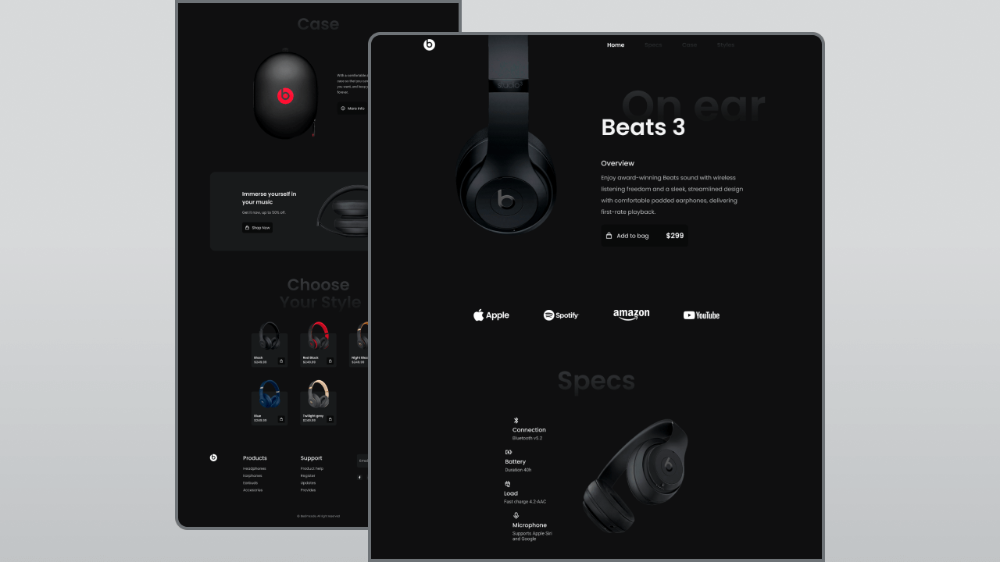

# Beats Product Landing Page 🎧

A modern, dark-themed responsive landing page for wireless headphones, built with clean semantic HTML5, CSS3, and vanilla JavaScript.

🔗 **[Live Demo](https://aziz208080.github.io/beats-landing/)**

## ✨ Key Features
- **Responsive Design:** Built using a Mobile-First approach, adapting seamlessly across mobile, tablet, and desktop screens.
- **Smooth Scroll Animations:** Interactive scroll reveal effects and smooth navigation between sections (`Home`, `Specs`, `Case`, `Products`).
- **Dark UI Aesthetic:** High-contrast dark interface tailored for modern consumer electronics.

## 🛠️ Tech Stack
- HTML5
- CSS3 (Flexbox & CSS Grid)
- JavaScript (ES6+)
- ScrollReveal.js
